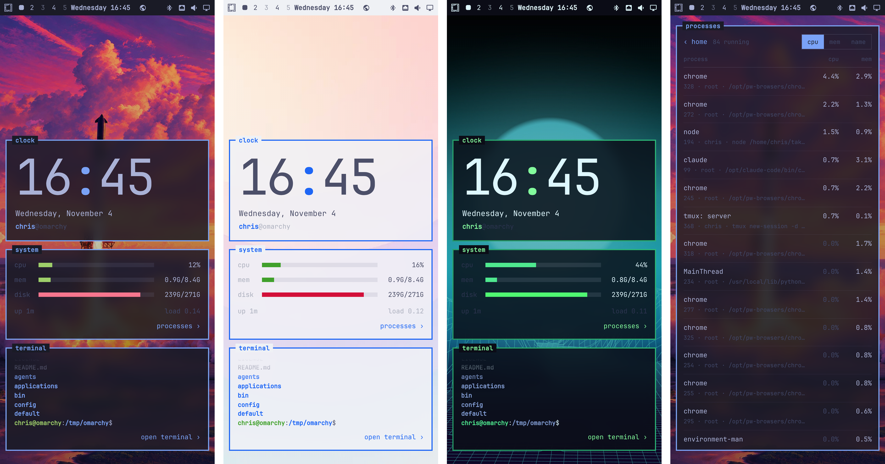
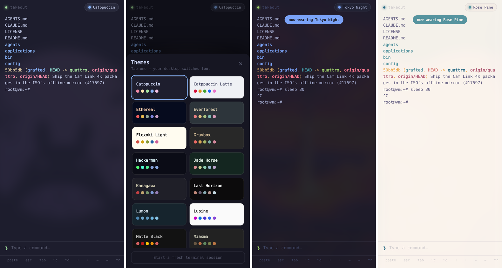

# 🥡 Takeout

**Your Omarchy desktop, to go.**

Takeout puts your Omarchy machine on your phone: a home screen that looks like your desktop, the same top bar and Omarchy menu, your computer's live screen with touch control, and a real terminal, all wearing your Omarchy theme. Change themes on your computer and your phone follows instantly.

No cloud. No account. No app store. It's an Omarchy plugin that runs on your computer, and your phone reaches it over your home Wi-Fi (or from anywhere, with a private VPN).



## Install

```bash
omarchy plugin add https://github.com/TouchWorkStation/Take-Out --enable
takeout pair
```

`takeout pair` prints a link and QR code. Open it on your phone, then **Share → Add to Home Screen**.

You can also add it from the [Omarchy plugin marketplace](https://plugins.omarchy.org), or from the menu: **Setup → Plugins → Add Plugin**.

**Your phone can't connect?** Omarchy's firewall blocks incoming connections. Run `takeout firewall` to let your home network through (it asks for your password and never opens the port to the internet).

**Away from home:** run `takeout vpn`. It sets up [Tailscale](https://tailscale.com), a free private network between your devices, and `takeout pair` then shows that link too.

**Update:** `omarchy plugin update io.github.touchworkstation.takeout`

## Uninstall

```bash
takeout uninstall
```

That removes Takeout and everything it added: the plugin, its firewall rules, the `takeout` tmux session, the `takeout` command, and its settings and cache in `~/.config/takeout` and `~/.cache/takeout`. Your Omarchy configuration is never changed.

To remove only the plugin and keep your pairing: `omarchy plugin remove io.github.touchworkstation.takeout`

## What it does

- **Your desktop, on your phone.** A home screen built the way Omarchy builds your desktop: your actual wallpaper, square windows with your theme's border (gradients too), and the same top bar, read from your own bar layout, with Omarchy's own icons. Widgets sit at the bottom near your thumb: a big clock, CPU, memory, disk, battery, and a live preview of your terminal.
- **The real Omarchy menu.** Tap the Omarchy logo for the same menu the logo opens on your desktop, built by Omarchy's own menu code from your menu file and extensions, with the same checkmarks. Pick something and it runs on your computer, just like clicking it there. Logout, reboot, shutdown, suspend and hibernate ask first.
- **Your screen, made for touch.** Tap the desktop widget, or launch anything from the menu (Install, Update, an app), and Takeout switches to your computer's live screen so you can finish it from wherever you are:
  - **tap** clicks exactly where your finger is, **double-tap** double-clicks
  - **long-press** or **two-finger tap** right-clicks, **long-press and drag** drags windows or selects text
  - **two-finger drag** scrolls, **pinch** zooms the view up to 5× (one finger pans while zoomed)
  - a **type** button for your phone's keyboard, sticky **super / ctrl / alt / shift**, esc, tab, arrows, and one-tap **Omarchy menu** (Super+Space), **terminal** and **close**
  - turn your phone sideways for a bigger screen; **next monitor** if you have several
- **Workspaces.** Tap a workspace in the bar to switch your desktop to it.
- **Processes.** Tap the system widget for every running process with live CPU and memory, sortable like btop.
- **A terminal built for thumbs.** Type on a normal prompt line and hit send. One-tap esc, tab, ^c, ^d, arrows, ^r and paste. Native scrolling and text selection.
- **Fast.** Commands echo back in about 40 ms on your Wi-Fi, and only the changed part of the screen travels to your phone.
- **Your theme, live.** Every color comes from your active Omarchy theme, including colored `ls`, `git`, 256-color and truecolor output. Change themes anywhere and the whole scrollback recolors instantly. There's a theme picker too, and Takeout serves the exact monospace font your desktop uses.
- **Never loses your place.** The session lives in tmux. Lock your phone, lose signal, come back: it's all still there. At your desk, `takeout attach` picks up the same session.
- **Sign-in links become taps.** When Claude Code, Codex or `gh` print a login URL, Takeout offers to open it on your phone.



## Commands

```
takeout pair       Pairing link + QR code for your phone
takeout status     Is it running?
takeout attach     Open the same session at your desk
takeout firewall   Let your phone through Omarchy's firewall (home network only)
takeout vpn        Reach Takeout away from home (sets up Tailscale)
takeout restart    Restart the server (your session keeps running)
takeout reset      New pairing token: unpairs every device
takeout uninstall  Remove Takeout and everything it added
```

## Dependencies

- **Omarchy 4** (Quattro). tmux ships with it.
- **Node.js 18+.** Install it with `omarchy install dev-env node` if you don't have it; Takeout tells you if it's missing. Takeout has **zero npm dependencies**.
- **Optional:** [`wayvnc`](https://github.com/any1/wayvnc) for the live screen (`sudo pacman -S wayvnc`; Takeout offers to install it the first time you open the screen), `qrencode` for the pairing QR code, `ufw` (Omarchy's firewall) for `takeout firewall`, and Tailscale for `takeout vpn`. `grim` (ships with Omarchy) draws the desktop widget's preview.

**Network:** Takeout only talks to your phone. The one outside request is the weather icon in the bar, which, exactly like Omarchy's own bar, asks [Open-Meteo](https://open-meteo.com) (or `wttr.in` when no location is set) every 15 minutes.

## Security

Takeout gives whoever pairs with it a shell as you, so it's built to stay private:

- **It stays on your own networks.** Takeout listens on your computer's network connections (your home Wi-Fi, plus Tailscale if you add it). `takeout firewall` opens its port to private home-network addresses and Tailscale only, never to the internet. Don't port-forward it; use `takeout vpn` instead.
- **Pairing token.** A random token in `~/.config/takeout/token` (mode 600). Pairing sets an HttpOnly, SameSite=Strict cookie, and `takeout reset` revokes every device at once.
- **Your screen is shared only while you look.** Takeout starts wayvnc when the phone opens the screen and stops it 45 seconds after you leave. wayvnc listens on a private Unix socket in your runtime directory (`$XDG_RUNTIME_DIR/takeout`, mode 700), never on the network; the phone reaches it only through Takeout's paired, same-site WebSocket.
- **The phone sends ids, not commands.** Menu rows, themes and keys are chosen from what's already on your computer: menu actions come only from your Omarchy menu files, theme names only from `omarchy-theme-list`, keys from a fixed list. Requests from any other website are refused.

To listen on just one address, set `TAKEOUT_HOST` or put the address in `~/.config/takeout/host`. Change the port with `TAKEOUT_PORT` (default `7777`).

## How it works

- **Terminal:** a tmux session named `takeout`. Input goes in with `tmux send-keys`, and the screen comes back from `tmux capture-pane`, pushed to your phone over Server-Sent Events as small diffs. This engine comes from [TouchWorkstation](https://touchworkstation.com).
- **Theme, bar and menu:** read live from Omarchy itself: `omarchy-theme-color` for colors, your `shell.json` bar layout, and Omarchy's own `MenuModel.js` for the menu.
- **Screen:** [wayvnc](https://github.com/any1/wayvnc) captures your Hyprland output; the phone draws it with [noVNC](https://github.com/novnc/noVNC) (vendored in `public/vendor/novnc`, MPL-2.0), with Takeout's own direct-touch gestures and zoom on top.
- **Plugin:** `Service.qml` keeps the server running inside the Omarchy shell and restarts it if it stops.

Not on Omarchy's plugin system? Clone this repo and run `./install.sh` to set it up as a systemd user service instead.

## Trade-off

Takeout shows tmux's text, not a pixel-perfect terminal emulator. Shells, scripts, git, and AI coding CLIs like Claude Code and Codex work great. Full-screen apps like `nvim`, `btop` and `lazygit` show as text snapshots rather than a live, interactive screen.

## License

MIT. noVNC, vendored in `public/vendor/novnc`, is MPL-2.0 (its bundled pako is MIT). Not affiliated with Omarchy or 37signals. Just a fan.
